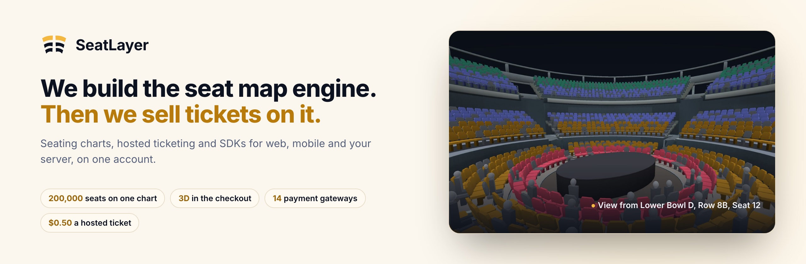
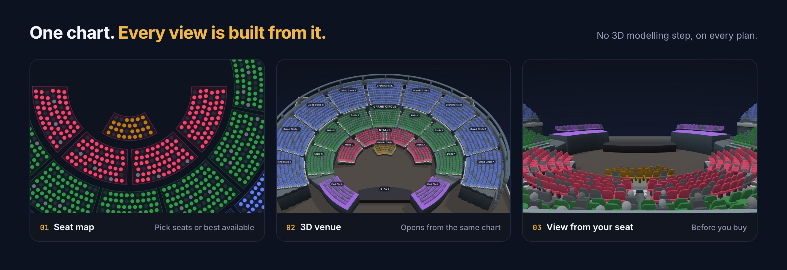

<picture>
  <source media="(prefers-color-scheme: dark)" srcset="./assets/seatlayer-hero-dark.jpg">
  
</picture>

**SeatLayer is reserved-seat ticketing and seating software:** organizers sell with hosted
checkout, a box office, door check-in and season tickets, and platforms add the same seat maps,
with 3D seat views, through the SeatLayer SDK and API.

[Website](https://seatlayer.io/) · [For developers](https://seatlayer.io/developers/) ·
[Documentation](https://docs.seatlayer.io/) · [Live demos](https://seatlayer.io/demo/) ·
[Pricing](https://seatlayer.io/pricing/) · [hello@seatlayer.io](mailto:hello@seatlayer.io)

## For organizers and venues

- **Sell on your own site.** An event page and checkout through your own payment account, with
  14 payment gateways including Stripe, PayPal, Square and Razorpay. [Sell tickets on your website](https://seatlayer.io/sell-tickets-on-your-website/)
- **Box office and door check-in.** Sell at the counter on the same live seats, and scan tickets
  at the door with the SeatLayer iPhone app or any phone browser. [Box office](https://seatlayer.io/box-office/)
- **Season tickets.** The same seat for every date of a season, with renewals. [Season tickets](https://seatlayer.io/season-tickets/)
- **3D in the checkout.** Charts open in 3D with the view from each seat, for venues up to 30,000 seats on phones and 60,000 on desktop,
  with no modelling step. [3D seat map](https://seatlayer.io/3d-seat-map/)
- **Any venue.** Draw it in the designer, start from a template, have an AI agent build and edit it
  through SeatLayer MCP for you to publish, or click one seat per block on your floor plan. [Venue designer](https://seatlayer.io/venue-designer/)

## SeatLayer SDK and API

The same charts inside your own product: a seat picker for the web, iOS, Android, Flutter and React Native, and
server SDKs that book the seats.

| Platform | Package | Guide |
| --- | --- | --- |
| JavaScript / TypeScript | [`@seatlayer/js`](https://www.npmjs.com/package/@seatlayer/js) | [JavaScript seat map SDK](https://docs.seatlayer.io/buyer-sdk/install/) |
| React, Vue, Angular | [seatlayer-sdk](https://github.com/seatlayer/seatlayer-sdk) | [React](https://docs.seatlayer.io/buyer-sdk/react/) · [Vue](https://docs.seatlayer.io/buyer-sdk/vue/) · [Angular](https://docs.seatlayer.io/buyer-sdk/angular/) |
| iOS (Swift, SwiftUI) | [seatlayer-ios](https://github.com/seatlayer/seatlayer-ios) | [iOS seat map SDK](https://docs.seatlayer.io/buyer-sdk/ios/) |
| Android (Kotlin, Compose) | [seatlayer-android](https://github.com/seatlayer/seatlayer-android) | [Android seat map SDK](https://docs.seatlayer.io/buyer-sdk/android/) |
| Flutter | [seatlayer-flutter](https://github.com/seatlayer/seatlayer-flutter) · [pub.dev](https://pub.dev/packages/seatlayer) | [Flutter seat picker](https://docs.seatlayer.io/buyer-sdk/flutter/) |
| React Native / Expo | [seatlayer-react-native](https://github.com/seatlayer/seatlayer-react-native) | [React Native seat map](https://docs.seatlayer.io/buyer-sdk/react-native/) |
| WordPress | [seatlayer-wordpress](https://github.com/seatlayer/seatlayer-wordpress) · [wordpress.org](https://wordpress.org/plugins/seatlayer-seating-charts/) | [WordPress seating chart plugin](https://docs.seatlayer.io/integrations/wordpress/) |

Server SDKs: [Node.js](https://github.com/seatlayer/seatlayer-node) · [Python](https://github.com/seatlayer/seatlayer-python) ·
[PHP](https://github.com/seatlayer/seatlayer-php) · [Java](https://github.com/seatlayer/seatlayer-java) ·
[Go](https://github.com/seatlayer/seatlayer-go) · [Ruby](https://github.com/seatlayer/seatlayer-ruby) ·
[.NET](https://github.com/seatlayer/seatlayer-dotnet). Season tickets are in the web and server SDKs.

Start: [quick start](https://docs.seatlayer.io/start/quickstart/) · examples for [React](https://github.com/seatlayer/seatlayer-react-example)
and [Next.js](https://github.com/seatlayer/seatlayer-nextjs-example) · [AI toolkit for coding agents](https://github.com/seatlayer/seatlayer-ai-toolkit)
· [moving from seats.io](https://docs.seatlayer.io/integrations/migrate-from-seatsio/)

## Pricing

- **Hosted Ticketing:** $0.50 per ticket, your first 25 free.
- **SDK and API:** 100 free sold seats every month, then 10 cents down to 5 cents a seat. No
  subscription, and credits you buy never expire.

## Proven at stadium scale

200,000 seats on one chart, ready in 1.95 s on desktop. Tested at 10,000 simulated concurrent buyers on one 12,000-seat event (18 September 2026): engine-side hold latency p99 9 ms, zero server errors. Method and run files:
[seatlayer-performance](https://github.com/seatlayer/seatlayer-performance) ·
[open the 200,000-seat stadium](https://app.seatlayer.io/demo/play/century-stadium-200k)

## Questions

**What is SeatLayer?** Reserved-seat ticketing and seating software: hosted checkout, box office,
door check-in and season tickets for organizers, and a seat map SDK and API for platforms, on the
same charts, with 3D seat views. One chart drives a 2D map benchmarked at 200,000 seats and, for venues up to 30,000 seats on phones and 60,000 on desktop,
the 3D venue and the view from each seat.

**What does it cost?** $0.50 per hosted ticket with the first 25 free, or on the SDK 100 free sold
seats a month, then 10 cents down to 5 cents a seat. No subscription.

**Which platforms does the SDK support?** Web (JavaScript, React, Vue, Angular), iOS, Android,
Flutter and React Native, with server SDKs for Node.js, Python, PHP, Java, Go, Ruby and .NET.
Every platform opens the same charts, and season tickets are in the web and server SDKs.

**Is 3D extra?** No. Charts open in 3D with the view from each seat on every plan, for venues up to 30,000 seats on phones and 60,000 on desktop.

**Can I move from seats.io?** Yes. Rebuild each chart in the Designer from your floor plan, a
template or a file; the migration guide maps seats.io events, categories, holds, channels, seasons
and webhooks to SeatLayer.
